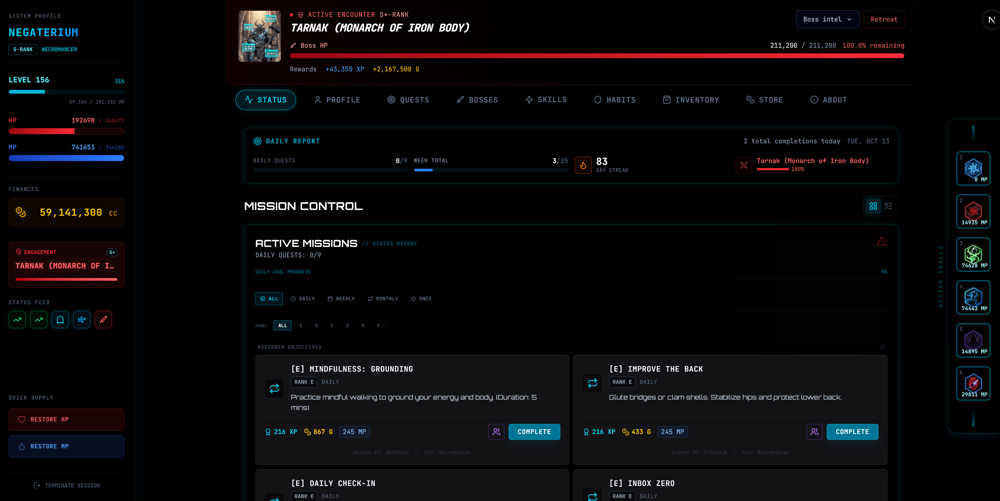
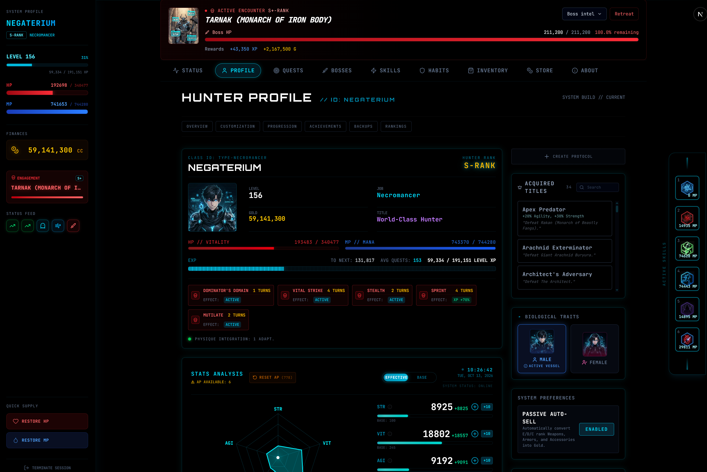
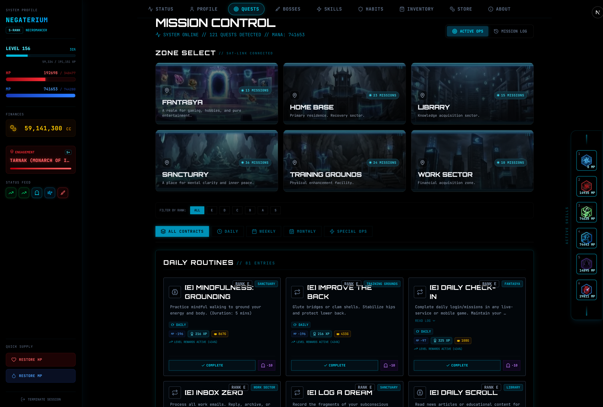
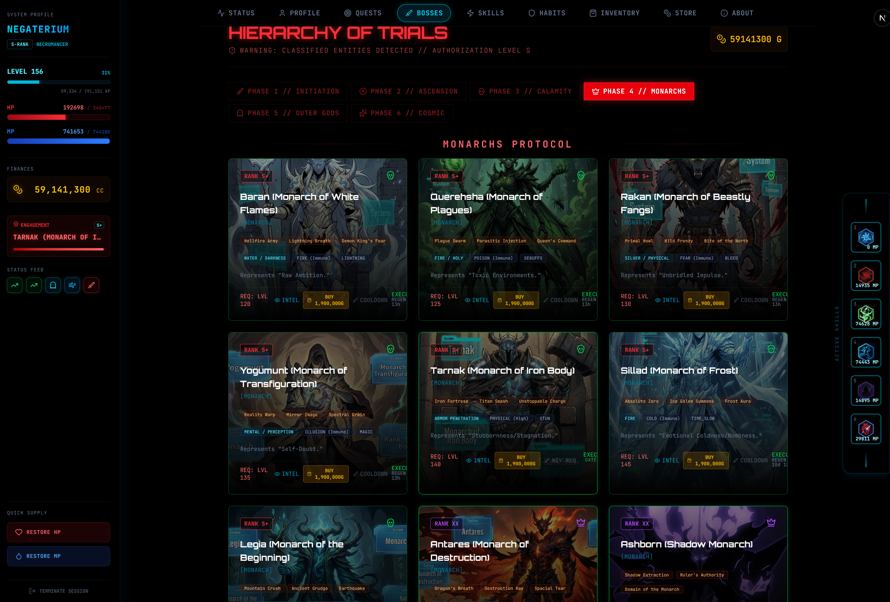
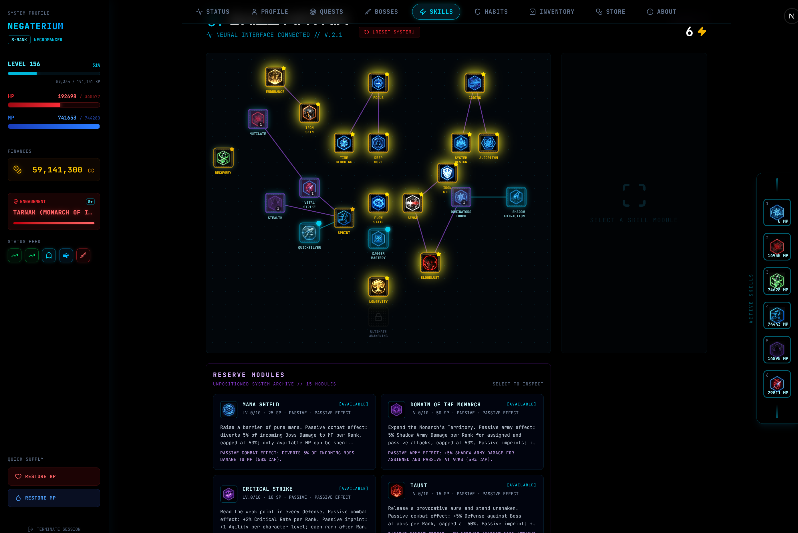
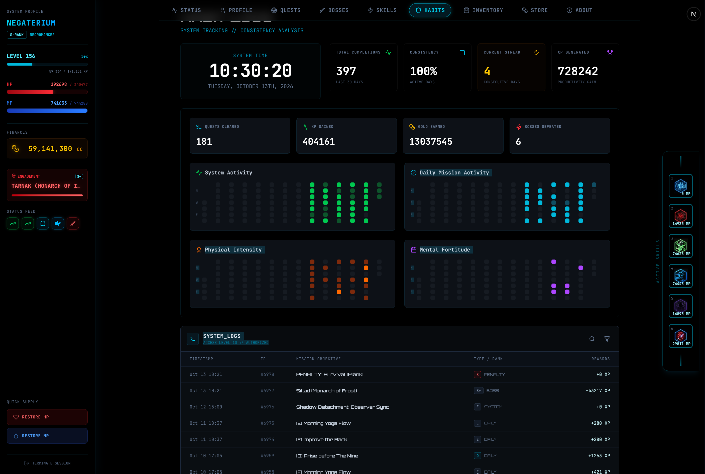
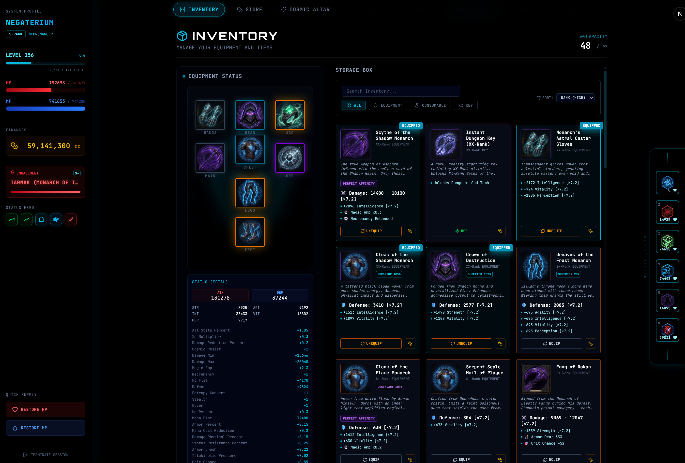
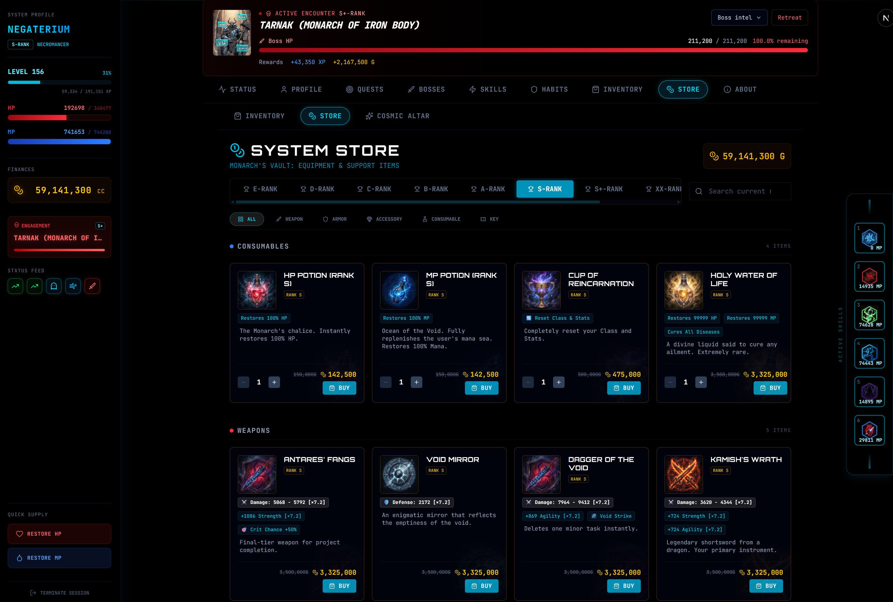

# Progression Protocol


> *"Progression Protocol will help you grow."*

**Progression Protocol** is an unofficial, non-commercial, fan-made gamified
life-management dashboard inspired by the *Solo Leveling* universe and other
RPG and fantasy sources. It transforms your real-world daily tasks, habits, and
self-improvement goals into "Quests" that grant Experience (XP), Gold, and Stat
increases, allowing you to literally level up your life.

This project is not affiliated with, endorsed by, sponsored by, or approved by
the rights holders of *Solo Leveling* or any other referenced property. The
maintainer does not intend to monetize it. See the complete
[fan-project notice](docs/FAN_PROJECT_NOTICE.md) before redistributing it.

---

## Screenshots

The captures below show the main areas of the running interface. Select any
image to open the original full-resolution PNG, or see the [screenshot notes](docs/screenshots/README.md)
for the display-permission and fan-project context.

<table>
  <tr>
    <td align="center"><strong>Status</strong><br><a href="docs/screenshots/STATUS.png"></a></td>
    <td align="center"><strong>Profile</strong><br><a href="docs/screenshots/PROFILE.png"></a></td>
  </tr>
  <tr>
    <td align="center"><strong>Quests</strong><br><a href="docs/screenshots/QUESTS.png"></a></td>
    <td align="center"><strong>Bosses</strong><br><a href="docs/screenshots/BOSSES.png"></a></td>
  </tr>
  <tr>
    <td align="center"><strong>Skills</strong><br><a href="docs/screenshots/SKILLS.png"></a></td>
    <td align="center"><strong>Habits</strong><br><a href="docs/screenshots/HABITS.png"></a></td>
  </tr>
  <tr>
    <td align="center"><strong>Inventory</strong><br><a href="docs/screenshots/INVENTORY.png"></a></td>
    <td align="center"><strong>Store</strong><br><a href="docs/screenshots/STORE.png"></a></td>
  </tr>
</table>

---

## 🌟 Capabilities

### 🛡️ Hunter Dashboard
- **Server-Backed HUD:** A persistent sidebar and vitals strip show current HP/MP, XP, Gold, combat stats, active boss state and recent rewards. Mutating server actions revalidate the dashboard views.
- **Leveling Engine:** Track progression from Level 1 through the Level 999 transcendence threshold and into post-cap systems with specialized Job Classes (Necromancer, Fighter, Mage, Assassin, and more).
- **Vitals Processing (HP/MP):** Manage life balance through an active **Mana (MP)** pool that is spent when you execute tasks, while failed obligations apply the configured HP penalties.

### 📅 Productivity Hub
- **Habit Tracking:** Custom, recurring routine management (Daily, Weekly, Monthly) with completion history and streak tracking.
- **Streak Protection (Shadow Observer):** Bounded offline recovery accepts eligible dates from the previous 90 days (up to 90 dates per request) and removes the matching penalty effects.
- **Persistent Mission Log:** A retro-futuristic terminal interface stores quest completion logs. The dashboard displays the latest 1,000 entries and the total recorded count.
- **Zone Organization:** Group related tasks into thematic "Zones" (e.g., *Sanctuary* for rest, *Work Sector* for career).

### ⚔️ The Living Arsenal — Dynamic Item Scaling
Equipment scaling is applied to selected positive numeric attributes in the Store and Inventory projections, effective-stat calculations, and dashboard summaries. Consumables, dungeon keys, boolean and percentage effects, and other utility values remain at their stored values. The current boss-combat round also receives some direct weapon and special equipment fields in raw form, so the implementation is a bounded scaling system rather than a guarantee that every item remains competitive forever.

- **Formula:** `scaleFactor = min(1 + level/25, rankCeiling)`
- **Rank Ceilings:** Each equipment rarity has a hard power ceiling, preserving the value of higher-tier loot drops.
- **Visual Indicators:** Store and Inventory entries display the current multiplier when level scaling applies (for example, `[×5.0]`), so you can compare current power with the stored base value.
- **Scalable Attributes:** The current list includes Strength, Agility, Intelligence, Vitality, Perception, Damage, Defense, HP/MP flats, Armor Penetration, Luck, Charisma, Focus and Willpower. Special flags, utility effects and non-positive values are not scaled.

| Rank | Power Ceiling | Hits Cap At Level |
|------|--------------|-------------------|
| E | ×5 | Level 100 |
| D | ×10 | Level 225 |
| C | ×25 | Level 600 |
| B | ×50 | Level 1,225 |
| A | ×100 | Level 2,475 |
| S | ×250 | Level 6,225 |
| S+ | ×500 | Level 12,475 |
| XX | ×1,000 | Level 24,975 |
| COSMIC | ×9,999 | Level 249,950 |

The cap levels above are derived from the formula. An unknown or missing item
rank uses the E-rank ceiling in the current implementation.

### ⛩️ Progression & Automation
- **The Shadow Army:** Specialized mechanics for the Necromancer class (unlocked at Level 40). Manage both **Infantry** (randomly extracted from dungeon runs) and **Elite Commanders** (extracted from defeated Bosses). Dispatch shadows to passively chip at Boss HP while you rest, or spend Infantry on Active *Siege Delegations* for massive burst damage.
- **Elite Command Limit:** The number of simultaneously summoned Boss Shadows is capped by `1 + floor(max(0, level - 40) / 20) + floor(intelligence / 500)`. Exceed the limit and newly extracted elites are auto-stored.
- **Beru's Delegation Buff:** Having the *Ant King (Beru)* summoned reduces delegation Infantry cost and duration by a percentage tied to Beru's level (capped at 90% reduction).
- **Auto-Sell System:** Configurable automatic liquidation of low-rank loot (E/D/C-Rank armor, weapons, accessories) upon Boss defeat, keeping the inventory clean.
- **Boss Raids:** Unique combat encounters with level-based prerequisites. Boss HP and attack scale from rank and player level within rank-specific caps; actual encounter duration depends on player damage, equipment, skills and quest cadence.
- **Inventory & Loot:** Earn scaling equipment drops, consumable potions, rare boss keys, and Quality Rolls from COMMON through SUPERIOR, LEGENDARY, PERFECT, TRANSCENDENT and COSMIC tiers, with bonus affixes where eligible.

---

## 🐉 Boss Combat System

When a boss battle starts, its maximum HP is calculated from the boss rank,
player level, the catalogued database HP and post-cap status. The result is a
balance formula; it does not promise a fixed number of days per encounter.

**HP Formula:**
`scaledHP = floor(baseHP × min(1 + level/20, rankScalingCap))`

The encounter stores `max(databaseHP or 1,000, scaledHP)`. Non-COSMIC bosses
receive a 2× post-cap multiplier for Level 999+ players; COSMIC bosses do not
receive that extra multiplier.

| Rank | Formula Base HP | Scaling Cap |
|------|----------------:|-------------:|
| E | 250 | ×25 |
| D | 600 | ×60 |
| C | 1,000 | ×120 |
| B | 2,200 | ×400 |
| A | 3,600 | ×1,500 |
| S | 16,000 | ×20 |
| S+ | 24,000 | ×40 |
| XX | 33,000 | ×100 |
| COSMIC | 5,000,000 | ×9,999 |

Boss attack uses the same level-and-cap pattern, then player defense applies the
`100 / (100 + DEF)` mitigation curve. High-rank encounters add minimum-damage
rules and a bounded per-hit damage cap.

**Necromancer Shadow Army:** Passive presence contributes up to
`maxHP × 0.008 × armyCapacityRatio × min(levelMultiplier, 1.5)` per quest
completion. An active siege uses a larger `maxHP × 0.10` base contribution and
its own level multiplier capped at ×2.5; it is stronger, but it is not uncapped.

---

## 🔐 Authentication

The System uses a **session-based authentication** model backed directly by PostgreSQL — no third-party auth providers required.

- **Session Storage:** Sessions are persisted in the `sessions` table and validated on every server action via `getAuthenticatedUser()`.
- **Player Provisioning:** `npm run db:create-user` creates credentials, profile and stats atomically. Developer privileges are configured separately by UUID.
- **Fresh Database Setup:** `npm run db:init` installs the reviewed schema baseline and shared catalogs into an empty, separately managed PostgreSQL database. See [database setup](database/README.md).

---

## 🛠️ Tech Stack & Architecture

Progression Protocol is designed for deployment to dedicated hardware or isolated VPS environments.

- **Frontend & Backend Framework:** [Next.js 16](https://nextjs.org/) (App Router, Server Actions)
- **Language:** [TypeScript](https://www.typescriptlang.org/)
- **Database:** [PostgreSQL](https://www.postgresql.org/) (accessed through the `pg` client)
- **Styling:** [Tailwind CSS](https://tailwindcss.com/)
- **Icons:** Lucide React

### Architecture Highlights
- **Server-First Rendering:** The dashboard fetches critical player data on the server before rendering. Client transitions still depend on the application and database response time.
- **AI-Agent Standards (`AGENTS.md`):** The repository documents strict contribution boundaries for AI pair programmers, including database integrity requirements.
- **Server-Side Dynamic Scaling:** Item and boss scaling formulas run on the server and the UI receives server-provided values. Some direct weapon and special equipment inputs in the current boss-combat path remain stored/raw values, as described in the Living Arsenal section.

---

## 🚀 Getting Started

### Prerequisites
- [Node.js 22 LTS](https://nodejs.org/en/) (22.20 or a newer 22.x patch).
- A separately managed **PostgreSQL 17** instance and an empty dedicated database for a new installation.

### Installation & Execution

1. **Clone the repository**
    ```bash
    git clone https://github.com/negaterium/progression-protocol-public.git progression-protocol
    cd progression-protocol
    ```

2. **Install dependencies**
    ```bash
    npm ci
    ```

3. **Configure Environment**
    Copy the safe template to a new local file and edit the copy with your database settings:
    ```sh
    cp .env.example .env.local
    npm run config:check -- --env-file .env.local --mode development
    ```
    PowerShell uses `Copy-Item .env.example .env.local`. Replace the template password before checking. Do not overwrite existing configuration. See [the setup guide](docs/SETUP.md) for every setting and its defaults.

4. **Initialize a New Database**
    Provision the empty database and its login role separately, then install the schema and shared catalogs:
    ```bash
    npm run db:init -- --target-database progression_protocol --confirm --env-file .env.local
    ```
    Existing installations keep their database unchanged; do not run the initializer against them. See [database setup and upgrade boundaries](database/README.md).

5. **Create a Playable User**
    Supply your desired username; enter the password in the concealed prompt:
    ```bash
    npm run db:create-user -- hunter --target-database progression_protocol --env-file .env.local
    npm run config:doctor -- --env-file .env.local --mode development
    ```
    This creates a normal player with no developer privileges. Future releases with
    numbered database migrations use the explicit `db:migrate` command described in
    [database setup](database/README.md); no migration runs during application startup.

6. **Launch Progression Protocol (Dev Server)**
    ```bash
    npm run dev
    ```
    Access the UI matrix at [http://localhost:9999](http://localhost:9999).

> **Deploying to production?** See the [Deployment Guide](DEPLOYMENT.md) for app-only Docker or Linux source deployment with separate PostgreSQL, HTTPS, updates, rollback and full backup recovery. The opt-in `compose.production.yml` binds host loopback for a host reverse proxy.

Fresh-install examples use the `progression_protocol` database name. Existing
deployments may keep the legacy `solo_leveling_system` database name; database
identifiers are compatibility details and should not be renamed solely for branding.

For the complete clone-to-login workflow and troubleshooting, use [Setup and Configuration](docs/SETUP.md). `npm run setup:verify` checks a clean source installation using disposable containers and separate PostgreSQL; it leaves the current deployment unchanged.

The mechanics and catalog organization for the skill matrix are documented in
the [Skill System Contract](docs/SKILL_SYSTEM.md), including the existing-database
catalog migration path. The full 38-module review ledger is in the
[Skill Audit Matrix](docs/SKILL_AUDIT.md).

---

## 🤝 Contributing & Community

Contributions are highly encouraged to expand Progression Protocol! Currently, we recommend:
- Submitting Bug Reports via GitHub Issues.
- Proposing significant features in an issue before committing large PRs.
- Adhering strictly to established `AGENTS.md` boundaries if using AI copilots.

See [CONTRIBUTING](CONTRIBUTING.md) for development and validation, and
[SECURITY](SECURITY.md) for vulnerability reporting. Issue/PR templates and a
read-only CI workflow accompany the repository.
Community expectations and support boundaries are in [CODE_OF_CONDUCT](CODE_OF_CONDUCT.md)
and [SUPPORT](SUPPORT.md).
CI checks tests, types, tooling lint, packaging integrity, disposable PostgreSQL
and HTTP authentication boundaries; it performs no deployment.
For a release candidate, follow the [public release checklist](docs/RELEASE_CHECKLIST.md)
and rebuild existing deployments from the locked package files.

---

## 📜 License

Original project code is licensed under the [MIT License](LICENSE).
Retained generated visual assets are released under [CC0 1.0](docs/ASSET_LICENSE.md)
to the extent that the project owner controls applicable rights. Project
screenshots captured from the running project are included under the display
permission described in [the screenshot notes](docs/screenshots/README.md);
private preparation binaries and third-party material remain excluded.
See [asset review](docs/ASSET_REVIEW.md) and [licensing scope](docs/LICENSING.md).
Passing CI verifies software integrity; it does not clear franchise names, lore,
characters or trademarks.
The copyright notice for owner-controlled code identifies [Negaterium](LICENSE);
this public name does not claim ownership of third-party fan-project material.

---

<p align="center">
  <i>System Message: "Arise."</i>
</p>
